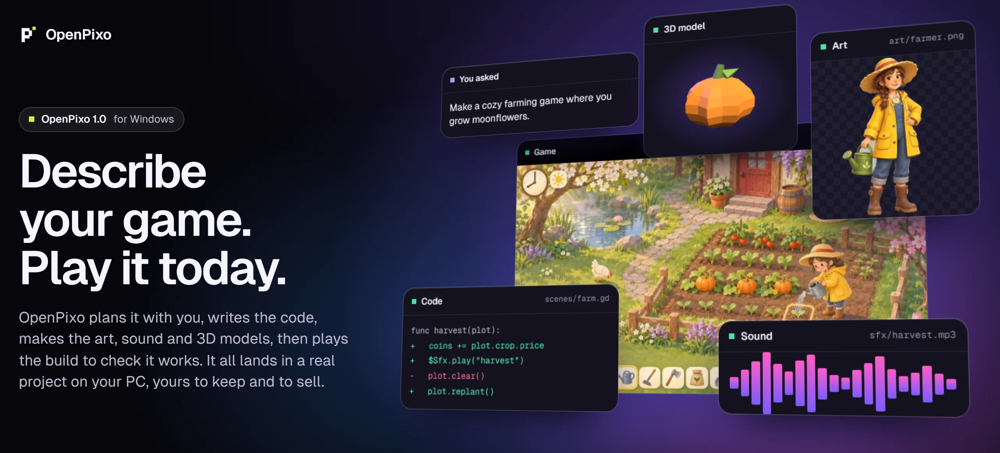
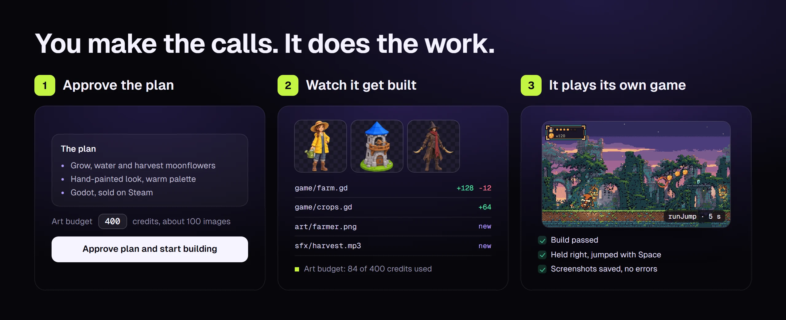
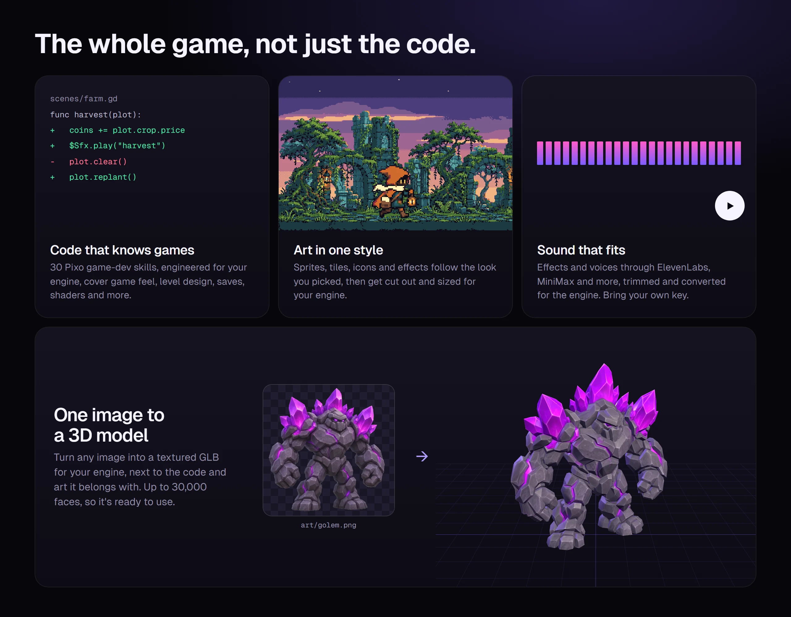
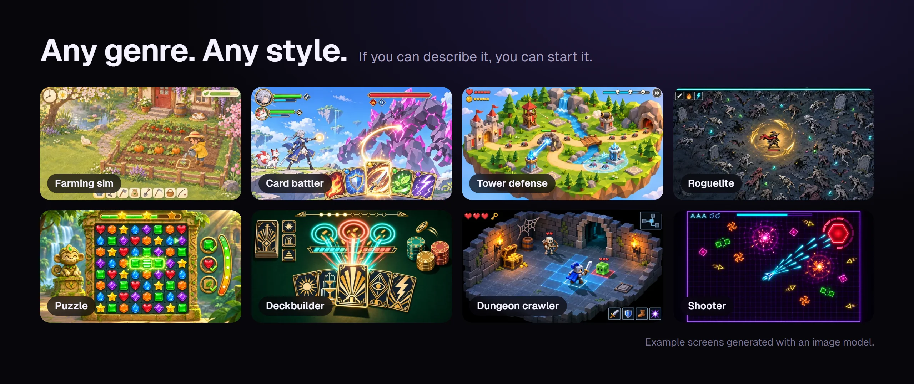
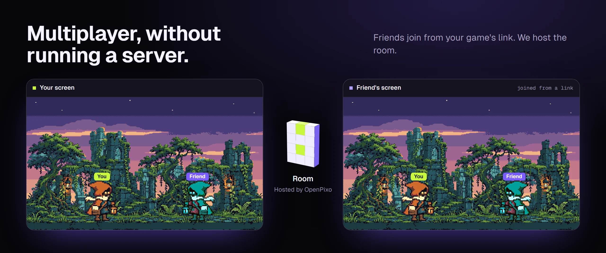

<p align="center">
  <a href="https://openpixo.com"></a>
</p>

<p align="center">
  <b>The AI workbench for indie game developers.</b><br>
  Code, art, sound, 3D models and playtests in one app, in a real project on your PC.
</p>

<p align="center">
  <a href="https://openpixo.com/download"></a>
  <a href="LICENSE"></a>
</p>

<p align="center">
  <a href="https://openpixo.com">Website</a> ·
  <a href="https://openpixo.com/download">Download</a> ·
  <a href="https://openpixo.com/pricing">Pricing</a> ·
  <a href="https://openpixo.com/changelog">Changelog</a> ·
  <a href="README.zh-CN.md">简体中文</a>
</p>

## Install

1. **Download** the installer from [openpixo.com/download](https://openpixo.com/download) (Windows 10 or 11, x64).
2. **Run it.** After that, updates download and install by themselves.
3. **Pick your AI.** Connect the Codex, Claude Code or OpenCode subscription you already have, or sign in and use hosted models with no API key.
4. **Describe your game.** Answer a few questions, approve the plan, and it starts building.

> [!NOTE]
> The installer is not code-signed yet, so Windows SmartScreen shows "Unknown publisher". Check the file's SHA256 against the value on the [download page](https://openpixo.com/download) (PowerShell: `Get-FileHash`), then choose **More info → Run anyway**.

## How it works

<p align="center"></p>

- **Talk it through first.** Every new game walks through gameplay, art style, engine and a short plan, one step at a time. Nothing is built until you approve the plan.
- **Stay in control of spending.** You set an art budget with the plan; the agent can't raise it.
- **Build in stages.** It builds one stage per turn, tells you how to try it, and waits for you. Every turn shows the files it changed and the media it made, right in the chat.
- **It plays its own game.** Built-in playtests run the build, press the keys and read the screenshots, so it catches what a code review can't.

## The whole game, not just the code

<p align="center"></p>

- **30 game-dev skills** for game feel, level design, saves, UI, shaders, multiplayer, Steam release and more. The agent reads the ones your problem needs.
- **Art recipes** for walk cycles, character turnarounds, tilesets, icons, effects, parallax layers, skyboxes and UI, cut out and sized for your engine.
- **Godot, Phaser and Unity**, with 10 game starters and 7 feature recipes: saves, settings, dialogue, inventory, gamepad, localization and achievements.
- **Your folder.** Open an existing game or start a new one. The files stay where they are, in a normal project you own.

## Any genre, any style

<p align="center"></p>

Farming sims, card battlers, tower defense, survivors-likes, puzzles, deckbuilders, dungeon crawlers, shooters, and whatever you can describe next.

## Share it and play together

<p align="center"></p>

- **Publish with one click.** Put a web game on a public link. Players need nothing installed.
- **Online features.** Ask for leaderboards, cloud saves, racing ghosts or async battles; OpenPixo hosts the backend.
- **Multiplayer rooms.** The agent writes the netcode and tests it with two players. Friends join a hosted room from your game's link, with no server to run.

## Your AI, or ours

- **Bring your own.** OpenPixo runs on the Codex, Claude Code or OpenCode you already use, and costs nothing on top.
- **Or use ours.** Sign in for hosted models, art, sound, 3D and public links without managing API keys. See [pricing](https://openpixo.com/pricing).

## Built for agents, too

Everything in the app is also a `pixo` command, so the agent working on your game, or any other agent, can use the same tools mid-task. Commands support `--json` and read long prompts from files.

```powershell
pixo game verify        # build the game and check it runs
pixo game playtest      # play it with scripted input and save screenshots
pixo recipe --help      # sprite sheets, tiles, icons, effects, sound packs, 3D
pixo asset --help       # cut out, resize, slice and check art for your engine
```

## Build from source

Use Node 24 and pnpm 10.33.2 on Windows. Native dependencies need Visual Studio Build Tools; see the [contributing guide](CONTRIBUTING.md) and [Windows troubleshooting](docs/windows-troubleshooting.md).

```powershell
pnpm install
pnpm tools-dev
```

`pnpm tools-dev` is the only development lifecycle entry point: run `pnpm tools-dev --help` for start, status, logs and stop. Contributors and coding agents start with [AGENTS.md](AGENTS.md).

## Documentation

- [Quickstart](QUICKSTART.md) · [Contributing](CONTRIBUTING.md) · [贡献指南](docs/i18n/CONTRIBUTING.zh-CN.md)
- [Running and building](docs/RUNNING.md) · [Architecture](docs/architecture.md) · [Prompt composition](docs/prompt-composition.md)
- [Skills protocol](docs/skills-protocol.md) · [Plugin authoring](docs/publishing-a-plugin.md) · [Privacy](PRIVACY.md)

## License

[Apache-2.0](LICENSE). OpenPixo began as a fork of another Apache-2.0 project; [NOTICE](NOTICE) and [references](docs/references.md) carry the attribution. Bundled components keep their own licenses.

<sub>Images in this README show example screens, art and models generated with OpenPixo's recipe prompts. Results vary by model.</sub>
