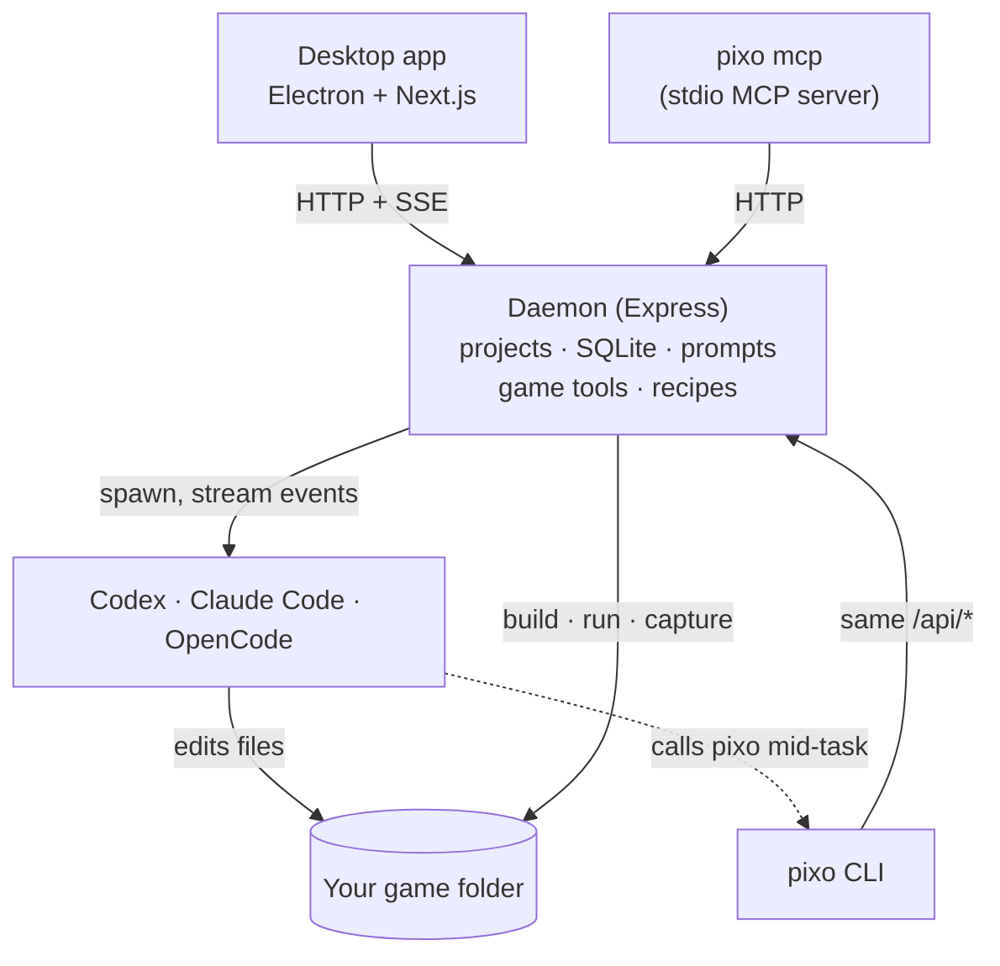

<p align="center">
  
</p>

<h1 align="center">OpenPixo</h1>

<p align="center">
  <b>A local harness that turns coding agents into game developers.</b><br>
  OpenPixo runs Codex, Claude Code or OpenCode on your real game project and gives them what a coding agent lacks for games:<br>
  engine detection, a build-run-playtest loop, asset pipelines, game-dev skills, and a plan the user must approve first.
</p>

<p align="center">
  <a href="LICENSE"></a>
  
  
  
</p>

<p align="center">
  <a href="#architecture">Architecture</a> ·
  <a href="#the-pixo-cli">CLI</a> ·
  <a href="#extending-openpixo">Extending</a> ·
  <a href="#build-from-source">Build from source</a> ·
  <a href="https://openpixo.com/download">Download the app</a> ·
  <a href="README.zh-CN.md">简体中文</a>
</p>

> [!TIP]
> Just want to make games? Get the Windows installer at **[openpixo.com](https://openpixo.com/download)**. This page is about how OpenPixo works and how to build or extend it.

## Why it exists

A general coding agent can write a game's code, but it can't see the game. It doesn't know how to build a Godot project or press keys in a running Phaser game, and it has nowhere to make sprites. Left alone, it also starts building before anyone has agreed what the game is. OpenPixo is the layer between the agent and the project that fills those gaps:

| A coding agent on its own | With OpenPixo |
| --- | --- |
| Edits files and runs shell commands | Also detects the engine and can **build, run, screenshot and playtest** the game with scripted input |
| Generates art only if you wire up an image API | Runs **asset recipes** (sprite sheets, tilesets, icons, VFX, SFX, music, 3D) whose candidates are cut, sized and checked for the engine |
| Decides on its own when to start building | Is held in a **read-only plan phase** until the user approves the plan, enforced per runtime |
| Spends whatever its tools allow | Spends media credits only inside a **daemon-enforced budget** the agent can't change |
| Knows game development from its training data | Loads **31 game-dev skills** on demand: game feel, tilemaps, saves, netcode, shaders, Steam release and more |

The agent stays your own: OpenPixo spawns the CLI you already have installed and signed in to, so your subscription and its model do the work.

## Architecture



- **The daemon is the only authority.** The web UI and the `pixo` CLI call the same `/api/*` endpoints, and shared DTOs live in `packages/contracts`. Every user-facing capability ships in both surfaces, so an agent can drive anything a person can click.
- **Agents call back in.** A spawned agent gets a scoped token and the project id, so it runs `pixo game verify` or `pixo recipe run` from its own shell like any other tool. Some routes, such as approving a plan or a budget, refuse that token.
- **Your files stay put.** Imported games are edited in place in the folder you picked. Daemon state lives in one resolved data root (see the [data directory contract](AGENTS.md#daemon-data-directory-contract)).

Full topology: [docs/architecture.md](docs/architecture.md).

### Agent runtimes

| Runtime | Transport | Notes |
| --- | --- | --- |
| **Codex** | `codex app-server` JSON-RPC over stdio | Sessions resume across turns |
| **Claude Code** | `-p` with stream-json input and output | Stdin stays open so the user can steer a running turn |
| **OpenCode** | OpenCode JSON events | Also used for **BYOK**: your own provider key through the same tool loop |

Each runtime is a declarative `RuntimeAgentDef` in `apps/daemon/src/runtimes/defs/`, and detection probes the same executable a run will spawn. With no upstream to absorb CLI protocol changes, every runtime is tested against **real recorded CLI sessions**, and [`mocks/`](mocks/README.md) replays them as drop-in fake CLIs for tests that never spend provider quota. Details: [docs/agent-adapters.md](docs/agent-adapters.md).

### The game loop

- **Engine detection** recognizes Godot, Unity, Unreal, Phaser, three.js, Cocos Creator, Bevy, RPG Maker and plain web projects, and works out the check, build and run commands for the project.
- **`pixo game verify`** runs those steps and can save a screenshot, so the agent sees whether its change actually renders.
- **`pixo game playtest`** plays the build with scripted input. Presets cover side-scrolling, WASD, grid clicks, drags and seeded random or "monkey" input; a preset plus a seed always replays the same run. Godot captures through its MovieMaker mode, and web engines run in a controlled browser.
- **`pixo game tuning`** finds numbers, flags and colors in Godot scenes and scripts and in web JSON data. It changes them in place, guarded by a file hash and a checkpoint, so balance tweaks don't need an agent turn.
- **`pixo game export`** writes a web game as a single HTML file that plays offline.

### Planning is a gate, not a prompt

A new game is planned with the user step by step: gameplay, art style, engine, then the plan. While planning, `startChatRun` forces Plan mode, and Plan mode is read-only on every runtime. Codex gets its `read-only` sandbox, Claude Code loses its edit tools, and OpenCode gets deny rules. Only the user can end planning, from the UI or `pixo game plan approve`; the approve route refuses an agent's token and waits while a run is active. Spending works the same way: the daemon prices every media request itself and reserves it against a budget only the user sets. See [AGENTS.md › Planning a new game](AGENTS.md#planning-a-new-game) and [Art budget](AGENTS.md#art-budget).

## The `pixo` CLI

Everything in the app is a `pixo` subcommand with `--json` output, and long prompts come from `--prompt-file <path|->`. That makes OpenPixo scriptable from CI or from any other agent.

```powershell
pixo game verify --steps check,build,run --screenshot --json
pixo game playtest --preset runJump --json
pixo game playtest --preset monkey --seed 42 --duration 15

pixo recipe list --surface image --engine godot
pixo recipe run tileset-seamless --input material="mossy cobblestone" --wait --json
pixo recipe adopt <runId> --candidate <id>      # recipes stage candidates; you choose what lands

pixo asset edit <projectId> art/hero.png --trim --pad pot --nearest
pixo asset provenance art/hero.png              # which recipe, model and prompt made it

pixo game tuning list --json                    # jump height, enemy speed, colors…
pixo game tuning set <id> 420
```

To use OpenPixo's project tools from an agent working in another repository, `pixo mcp` runs a stdio MCP server that proxies to the local daemon. A REST-only setup with your own model provider is in [docs/headless-byok.md](docs/headless-byok.md).

## Extending OpenPixo

All of these are plain folders in the repository, and the daemon also scans a user-writable root, so your own copy can override a bundled one with the same id.

| Extension | Where | Format |
| --- | --- | --- |
| **Skills** (31) | [`skills/`](skills/) | `SKILL.md` with frontmatter: triggers, engines, mode. The agent reads one only when the task needs it. [Protocol](docs/skills-protocol.md) |
| **Recipes** (30) | [`plugins/_official/recipes/`](plugins/_official/recipes/) | `pixo.json` (`urn:openpixo:plugin:v1`) declaring typed inputs, the target engine and post-processing. 13 asset recipes, 10 game starters, 7 feature recipes |
| **Art styles** (20) | [`plugins/_official/styles/`](plugins/_official/styles/) | Data-only bundles: style and negative prompt fragments, palette, constraints. A project pins one so its art stays consistent |
| **Plugins** | [`plugins/`](plugins/README.md) | Installable bundles with marketplace metadata. [Spec](docs/plugins-spec.md) · [Publishing](docs/publishing-a-plugin.md) |
| **MCP servers** | Settings or `pixo mcp add` | External tools passed to the agent per run, without writing into your game's repository |

## Repository layout

```text
apps/
  daemon/     Express daemon and the pixo CLI: /api/*, agent runs, game tools, recipes
  web/        Next.js 16 UI (React 18), served by the daemon in production
  desktop/    Electron shell
  packaged/   packaged runtime entry for the Windows installer
packages/
  contracts/  pure TypeScript API contracts and the shared game prompt
  sidecar*/   process identity, IPC and lifecycle shared by every launcher
  components/ shared UI primitives
tools/
  dev/        pnpm tools-dev: the one local lifecycle entry point
  pack/       installers, auto-update and packaged smoke tests
  release/    release metadata and publishing
skills/  plugins/  mocks/  e2e/
```

Each layer has its own `AGENTS.md` with its boundaries. Start with the root [AGENTS.md](AGENTS.md); it is written for human contributors and coding agents alike.

## Build from source

Windows 10 or 11 is the release platform and the primary development machine. The inherited macOS and Linux tooling still builds, but neither platform is a release target yet.

**Requirements:** Node 24, pnpm 10.33.2, and Visual Studio Build Tools 2022 or newer, because `better-sqlite3` compiles from source on Node 24.

```powershell
pnpm install
pnpm tools-dev                       # daemon + web + desktop, ports picked for you
pnpm tools-dev run web               # daemon + web only, in the foreground
pnpm tools-dev status --json
pnpm tools-dev stop
```

You'll also need at least one agent CLI installed and signed in (Codex, Claude Code or OpenCode), or a provider key for BYOK. Before opening a PR:

```powershell
pnpm guard                           # repository rules
pnpm typecheck
pnpm --filter @openpixo/daemon test  # or the package you changed
```

Setup problems: [Windows troubleshooting](docs/windows-troubleshooting.md) · [Running and building](docs/RUNNING.md).

## Hosted services

Signing in is optional. With your own agent CLI or provider key, everything in this repository runs locally. The hosted service behind sign-in runs separately and isn't part of this repository. It covers accounts, credits, hosted models and media, public game links, online features and multiplayer rooms. The client side of it is here, under `apps/daemon/src/account`, `online` and `media`.

## Contributing

Issues and pull requests are welcome. Read [CONTRIBUTING.md](CONTRIBUTING.md) and [AGENTS.md](AGENTS.md) first, and open an issue before starting a large feature. Report security problems privately as described in [SECURITY.md](.github/SECURITY.md).

**Docs:** [Architecture](docs/architecture.md) · [Agent adapters](docs/agent-adapters.md) · [Prompt composition](docs/prompt-composition.md) · [Skills protocol](docs/skills-protocol.md) · [Plugins spec](docs/plugins-spec.md) · [ADRs](docs/adr/) · [Glossary](docs/glossary.md) · [Code review guide](docs/code-review-guidelines.md) · [Privacy](PRIVACY.md)

## License

[Apache-2.0](LICENSE). OpenPixo began as a hard fork of another Apache-2.0 project and no longer tracks it ([ADR 0006](docs/adr/0006-full-hard-fork.md)); [NOTICE](NOTICE) and [references](docs/references.md) carry the attribution. Bundled skills and components keep their own licenses.
