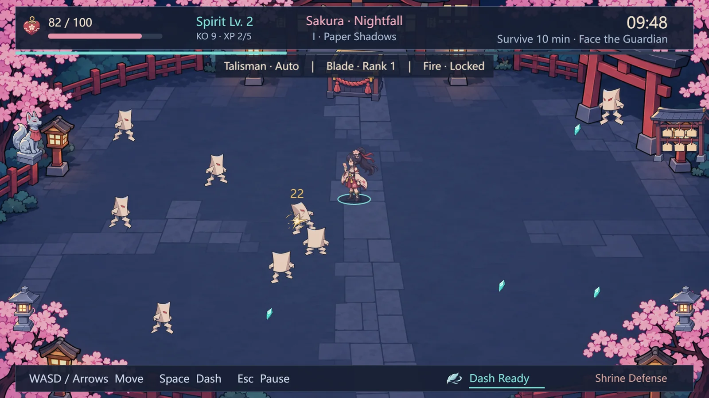
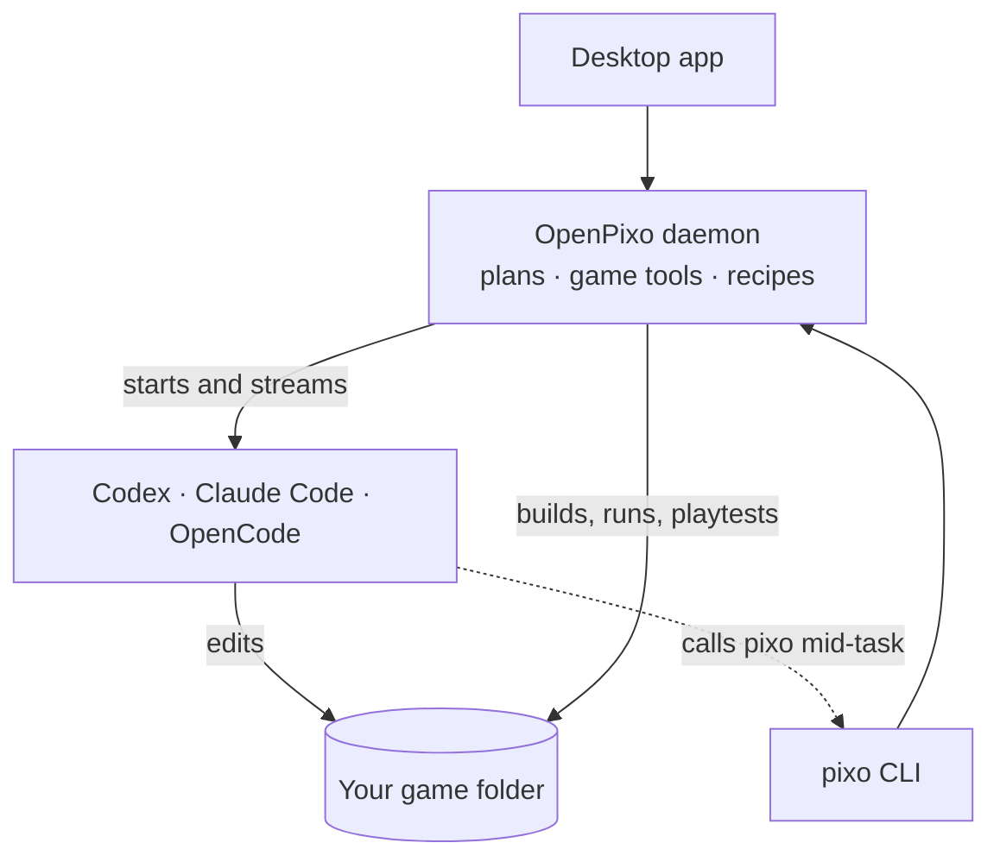

<p align="center">
  
</p>

<h1 align="center">OpenPixo</h1>

<p align="center">
  <b>Turn the coding agent you already use into a game developer.</b><br>
  OpenPixo runs Codex, Claude Code or OpenCode on your real game project, and lets it see, play and art-direct the game, not just write its code.
</p>

<p align="center">
  <a href="https://openpixo.com/download"></a>
  <a href="LICENSE"></a>
  
</p>

<p align="center">
  <a href="#installation">Installation</a> ·
  <a href="#quick-start">Quick start</a> ·
  <a href="#how-it-works">How it works</a> ·
  <a href="#documentation">Docs</a> ·
  <a href="README.zh-CN.md">简体中文</a>
</p>

<p align="center"></p>
<p align="center"><sub><b>Sakura Nightfall</b>, made in OpenPixo by Codex in five stages. The agent wrote the code, generated the sprites, animation and UI art, and playtested every stage itself.</sub></p>

## Why OpenPixo

- **Uses the AI you already pay for.** It runs the Codex, Claude Code or OpenCode CLI on your machine, with your own subscription or API key. Nothing extra to pay.
- **It plays the game, not just compiles it.** It builds and runs the game, plays it with scripted keyboard and mouse input, and reads the screenshots, so it catches what a passing build hides.
- **Art, sound and 3D in the same loop.** Recipes make sprite sheets, walk cycles, tilesets, icons, effects, music and 3D models, already cut out and sized for your engine.
- **You decide before it builds.** Every new game starts with a short plan. The agent is read-only until you approve it, and it can't raise its own art budget.
- **Real engines, your folder.** It works with Godot, Unity, Phaser and plain web games, in a new project or one you already have. Your files stay where they are.
- **Scriptable end to end.** Everything in the app is also a `pixo` command with `--json` output, so CI and other agents can use it too.

## Installation

### Windows app

1. Download the installer from **[openpixo.com/download](https://openpixo.com/download)** (Windows 10 or 11, x64).
2. Run it. Updates install themselves after that.
3. On first launch, connect an AI: the Codex, Claude Code or OpenCode CLI you're signed in to, or your own API key. Signing in to OpenPixo for hosted models is optional.

> [!NOTE]
> The installer isn't code-signed yet, so Windows SmartScreen shows "Unknown publisher". Compare the file's SHA256 (`Get-FileHash` in PowerShell) with the value on the [download page](https://openpixo.com/download), then choose **More info → Run anyway**.

### From source

You need Node 24, pnpm 10.33.2 and Visual Studio Build Tools 2022 or newer (one native dependency compiles from source).

```powershell
git clone https://github.com/OpenPixo/OpenPixo.git
cd OpenPixo
pnpm install
pnpm tools-dev        # starts the daemon, web UI and desktop app
```

`pnpm tools-dev --help` lists status, logs and stop. Windows is the supported platform; the macOS and Linux tooling still builds but isn't tested for release. Problems: [Windows troubleshooting](docs/windows-troubleshooting.md).

## Quick start

1. **Start a game.** Click **New game** and describe it in a sentence, or open a folder that already has a game in it.
2. **Agree on the plan.** The agent walks you through gameplay, art style and engine, shows a few style samples, then proposes 3–6 stages. Nothing is built until you approve.
3. **Play each stage.** It builds one stage per turn, plays it, and tells you how to try it. Use **Run**, **Playtest** and **Tune** in the game panel, or just tell it what feels off.

The same tools from a terminal, or from an agent working in another repo:

```powershell
pixo game verify --screenshot          # build, run and capture a frame
pixo game playtest --preset runJump    # play it with scripted input
pixo recipe run tileset-seamless --input material="mossy cobblestone" --wait
pixo --help
```

## How it works



A local daemon owns your projects. The desktop app and the `pixo` CLI call the same API. When you send a message, the daemon starts your agent CLI in the game's folder with a game-development prompt and the skills the task needs. The agent then calls `pixo` itself to build, playtest and make art. The plan approval and the art budget are enforced in the daemon, not only asked for in the prompt.

More: [Architecture](docs/architecture.md) · [Agent adapters](docs/agent-adapters.md) · [Prompt composition](docs/prompt-composition.md)

## Documentation

- **Using it:** [Quickstart](QUICKSTART.md) · [Running and building](docs/RUNNING.md) · [Headless runs over REST](docs/headless-byok.md) · [Privacy](PRIVACY.md)
- **Extending it:** [Skills](docs/skills-protocol.md) (31 bundled in [`skills/`](skills/)) · [Plugins and recipes](docs/plugins-spec.md) · [Publishing a plugin](docs/publishing-a-plugin.md)
- **Working on it:** [AGENTS.md](AGENTS.md) (repository rules, for people and coding agents) · [ADRs](docs/adr/) · [Glossary](docs/glossary.md)

## Contributing

Bug reports, ideas and pull requests are welcome in [issues](https://github.com/OpenPixo/OpenPixo/issues). Please read [CONTRIBUTING.md](CONTRIBUTING.md) first, and open an issue before starting a large feature. Security problems: see [SECURITY.md](.github/SECURITY.md).

## License

[Apache-2.0](LICENSE). OpenPixo began as a hard fork of another Apache-2.0 project; [NOTICE](NOTICE) and [references](docs/references.md) carry the attribution.
