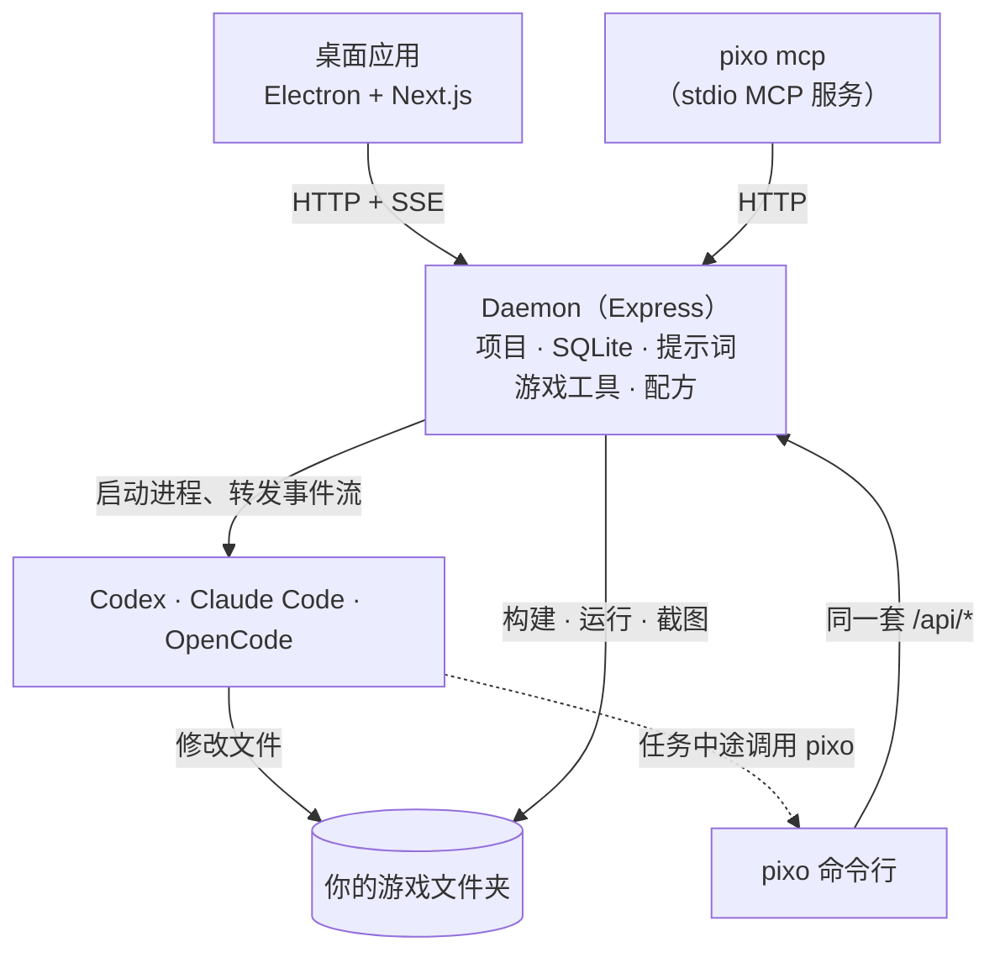

<p align="center">
  
</p>

<h1 align="center">OpenPixo</h1>

<p align="center">
  <b>把编程 agent 变成游戏开发者的本地运行框架。</b><br>
  OpenPixo 在你真实的游戏项目上运行 Codex、Claude Code 或 OpenCode，并补上编程 agent 做游戏时缺的东西：<br>
  引擎识别、构建-运行-试玩循环、素材管线、游戏开发技能，以及必须先经用户批准的计划。
</p>

<p align="center">
  <a href="LICENSE"></a>
  
  
  
</p>

<p align="center">
  <a href="#架构">架构</a> ·
  <a href="#pixo-命令行">命令行</a> ·
  <a href="#扩展-openpixo">扩展</a> ·
  <a href="#从源码构建">从源码构建</a> ·
  <a href="https://openpixo.com/download.zh">下载应用</a> ·
  <a href="README.md">English</a>
</p>

> [!TIP]
> 只想做游戏？到 **[openpixo.com](https://openpixo.com/download.zh)** 下载 Windows 安装包。本页讲的是 OpenPixo 的工作原理，以及怎么构建和扩展它。

## 为什么要有它

通用编程 agent 能写游戏代码，却看不到游戏本身：它不知道怎么构建 Godot 项目，不会在运行中的 Phaser 游戏里按键，也没有地方做精灵图。放任不管的话，它还会在大家没商量好做什么游戏之前就动手。OpenPixo 是夹在 agent 和项目之间的那一层，负责补上这些：

| 只有编程 agent | 加上 OpenPixo |
| --- | --- |
| 改文件、跑 shell 命令 | 还能识别引擎，**构建、运行、截图并用脚本化输入试玩**游戏 |
| 除非你自己接图像 API，否则做不了美术 | 运行**素材配方**（精灵图、地块、图标、特效、音效、音乐、3D），候选结果按引擎裁切、缩放并检查 |
| 自己决定什么时候开工 | 在用户批准计划前，处于**只读的计划阶段**，按每种运行时分别强制执行 |
| 工具允许多少就花多少 | 只能在**由 daemon 强制执行的预算**内花媒体额度，agent 改不了预算 |
| 游戏开发知识全靠训练数据 | 按需读取 **31 个游戏开发技能**：手感、瓦片地图、存档、网络同步、着色器、Steam 发布等 |

agent 仍然是你自己的：OpenPixo 启动的是你已经安装并登录的 CLI，干活的是你的订阅和它的模型。

## 架构



- **daemon 是唯一的权威。** 网页界面和 `pixo` 命令行调用同一套 `/api/*`，共享的数据结构在 `packages/contracts`。每项面向用户的功能都同时有界面和命令行，所以人能点的，agent 都能调用。
- **agent 会回调进来。** 被启动的 agent 拿到一个限定范围的令牌和项目 id，就能在自己的 shell 里像用其他工具一样运行 `pixo game verify` 或 `pixo recipe run`。批准计划、设定预算这类路由会拒绝这个令牌。
- **文件留在原处。** 导入的游戏就在你选的文件夹里直接修改。daemon 的状态都放在一个解析出来的数据根目录下（见[数据目录约定](AGENTS.md#daemon-data-directory-contract)）。

完整拓扑见 [docs/architecture.md](docs/architecture.md)。

### Agent 运行时

| 运行时 | 通信方式 | 说明 |
| --- | --- | --- |
| **Codex** | 通过 stdio 的 `codex app-server` JSON-RPC | 会话跨轮次续接 |
| **Claude Code** | `-p`，输入输出都是 stream-json | stdin 保持打开，用户可以在一轮运行中途引导 |
| **OpenCode** | OpenCode JSON 事件 | 也用于 **BYOK**：用你自己的服务商密钥跑同一套工具循环 |

每种运行时都是 `apps/daemon/src/runtimes/defs/` 里的一个声明式 `RuntimeAgentDef`，检测时探测的就是运行时要启动的那个可执行文件。没有上游替我们跟进 CLI 协议变化，所以每种运行时都用**真实录制的 CLI 会话**来测试；[`mocks/`](mocks/README.md) 把这些录制回放成可直接替换的假 CLI，测试不花服务商额度。详见 [docs/agent-adapters.md](docs/agent-adapters.md)。

### 游戏循环

- **引擎识别**能认出 Godot、Unity、Unreal、Phaser、three.js、Cocos Creator、Bevy、RPG Maker 和普通网页项目，并推出这个项目的检查、构建和运行命令。
- **`pixo game verify`** 执行这些步骤，还可以保存截图，让 agent 看到自己的改动是否真的渲染出来。
- **`pixo game playtest`** 用脚本化输入试玩构建结果。预设覆盖横版、WASD、网格点击、拖拽，以及带种子的随机或乱按（monkey）输入；同一个预设加同一个种子，每次回放都一样。Godot 通过 MovieMaker 模式录制，网页引擎在受控的浏览器里运行。
- **`pixo game tuning`** 找出 Godot 场景、脚本和网页 JSON 数据里的数值、开关和颜色，并在原处修改；修改受文件哈希和检查点保护，调平衡不用再开一轮 agent。
- **`pixo game export`** 把网页游戏导出成一个可离线游玩的 HTML 文件。

### 计划是一道闸，不是一段提示词

新游戏会和用户一步一步地规划：玩法、画风、引擎，然后是计划。规划期间，`startChatRun` 强制进入计划模式，而计划模式在每种运行时上都是只读的：Codex 用 `read-only` 沙箱，Claude Code 去掉编辑工具，OpenCode 加上拒绝规则。只有用户能结束规划，在界面里或用 `pixo game plan approve`；批准路由会拒绝 agent 的令牌，并在有运行进行时等待。花费也一样：每个媒体请求都由 daemon 自己定价，并从只有用户能设定的预算里预留。见 [AGENTS.md › Planning a new game](AGENTS.md#planning-a-new-game) 和 [Art budget](AGENTS.md#art-budget)。

## `pixo` 命令行

应用里的一切都是 `pixo` 子命令，支持 `--json` 输出，长提示词用 `--prompt-file <path|->` 读入。所以 CI 或任何其他 agent 都能用脚本驱动 OpenPixo。

```powershell
pixo game verify --steps check,build,run --screenshot --json
pixo game playtest --preset runJump --json
pixo game playtest --preset monkey --seed 42 --duration 15

pixo recipe list --surface image --engine godot
pixo recipe run tileset-seamless --input material="mossy cobblestone" --wait --json
pixo recipe adopt <runId> --candidate <id>      # 配方只暂存候选结果，留哪个由你决定

pixo asset edit <projectId> art/hero.png --trim --pad pot --nearest
pixo asset provenance art/hero.png              # 是哪个配方、模型和提示词做出来的

pixo game tuning list --json                    # 跳跃高度、敌人速度、颜色……
pixo game tuning set <id> 420
```

如果想让在其他仓库里工作的 agent 使用 OpenPixo 的项目工具，`pixo mcp` 会运行一个转发到本地 daemon 的 stdio MCP 服务。只用 REST、配合你自己的模型服务商的用法见 [docs/headless-byok.md](docs/headless-byok.md)。

## 扩展 OpenPixo

下面这些都是仓库里的普通文件夹。daemon 还会扫描一个用户可写的目录，同 id 的自有副本可以覆盖内置的那份。

| 扩展 | 位置 | 格式 |
| --- | --- | --- |
| **技能**（31） | [`skills/`](skills/) | 带 frontmatter 的 `SKILL.md`：触发词、引擎、模式。agent 只在任务需要时读取。[协议](docs/skills-protocol.md) |
| **配方**（30） | [`plugins/_official/recipes/`](plugins/_official/recipes/) | `pixo.json`（`urn:openpixo:plugin:v1`），声明带类型的输入、目标引擎和后处理。13 个素材配方、10 个游戏起步模板、7 个功能配方 |
| **画风**（20） | [`plugins/_official/styles/`](plugins/_official/styles/) | 纯数据包：正向和反向提示词片段、调色板、约束。项目固定一个画风，美术就能保持一致 |
| **插件** | [`plugins/`](plugins/README.zh-CN.md) | 带市场元数据的可安装包。[规范](docs/plugins-spec.zh-CN.md) · [发布](docs/publishing-a-plugin.zh-CN.md) |
| **MCP 服务** | 设置或 `pixo mcp add` | 每次运行时传给 agent 的外部工具，不会写进你游戏的仓库 |

## 仓库结构

```text
apps/
  daemon/     Express daemon 和 pixo 命令行：/api/*、agent 运行、游戏工具、配方
  web/        Next.js 16 界面（React 18），生产环境由 daemon 提供
  desktop/    Electron 外壳
  packaged/   Windows 安装包的打包运行入口
packages/
  contracts/  纯 TypeScript 的 API 契约和共享的游戏提示词
  sidecar*/   所有启动器共用的进程身份、IPC 和生命周期
  components/ 共享的界面基础组件
tools/
  dev/        pnpm tools-dev：唯一的本地生命周期入口
  pack/       安装包、自动更新和打包冒烟测试
  release/    发布元数据和发布流程
skills/  plugins/  mocks/  e2e/
```

每一层都有自己的 `AGENTS.md`，写明这一层的边界。先读根目录的 [AGENTS.md](AGENTS.md)，它同时写给人类贡献者和编程 agent。

## 从源码构建

Windows 10 或 11 是发布平台，也是主要的开发机器。继承下来的 macOS 和 Linux 工具链仍然能构建，但这两个平台暂时都不是发布目标。

**需要：** Node 24、pnpm 10.33.2，以及 Visual Studio Build Tools 2022 或更新版本（`better-sqlite3` 在 Node 24 上要从源码编译）。

```powershell
pnpm install
pnpm tools-dev                       # daemon + web + 桌面端，端口自动分配
pnpm tools-dev run web               # 只启动 daemon + web，在前台运行
pnpm tools-dev status --json
pnpm tools-dev stop
```

你还需要至少装好并登录一个 agent CLI（Codex、Claude Code 或 OpenCode），或者准备一个用于 BYOK 的服务商密钥。提交 PR 前：

```powershell
pnpm guard                           # 仓库规则检查
pnpm typecheck
pnpm --filter @openpixo/daemon test  # 或你改动的那个包
```

环境问题见 [Windows 排障](docs/windows-troubleshooting.md) · [运行与构建](docs/RUNNING.md)。

## 托管服务

登录是可选的。用你自己的 agent CLI 或服务商密钥，本仓库里的一切都在本地运行。登录背后的托管服务单独运行，不在本仓库里，它提供账号、额度、托管模型和媒体、公开游戏链接、在线功能和联机房间。它的客户端部分在这里，位于 `apps/daemon/src/account`、`online` 和 `media`。

## 参与贡献

欢迎提 issue 和 pull request。请先读[贡献指南](docs/i18n/CONTRIBUTING.zh-CN.md)和 [AGENTS.md](AGENTS.md)，较大的功能请先开 issue 讨论。安全问题请按 [SECURITY.md](.github/SECURITY.md) 私下报告。

**文档：** [架构](docs/architecture.md) · [Agent 适配](docs/agent-adapters.md) · [提示词组合](docs/prompt-composition.md) · [Skills 协议](docs/skills-protocol.md) · [插件规范](docs/plugins-spec.zh-CN.md) · [ADR](docs/adr/) · [术语表](docs/glossary.md) · [代码审查指南](docs/code-review-guidelines.md) · [隐私](PRIVACY.md)

## 许可证

[Apache-2.0](LICENSE)。OpenPixo 最初是另一个 Apache-2.0 项目的硬分叉，现已不再跟进上游（[ADR 0006](docs/adr/0006-full-hard-fork.md)）；署名见 [NOTICE](NOTICE) 与[引用记录](docs/references.md)。内置的技能和组件保留各自的许可证。
