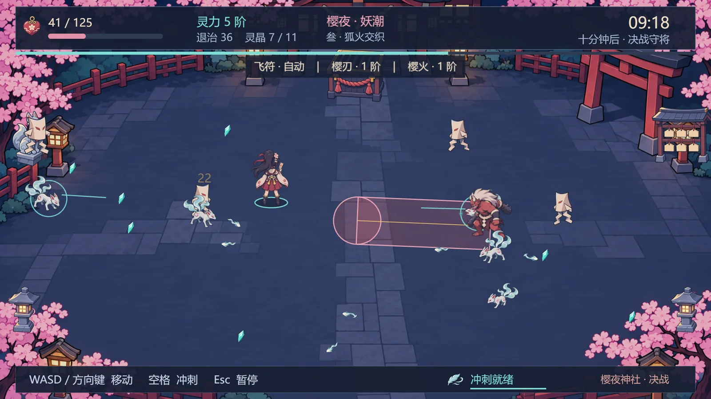
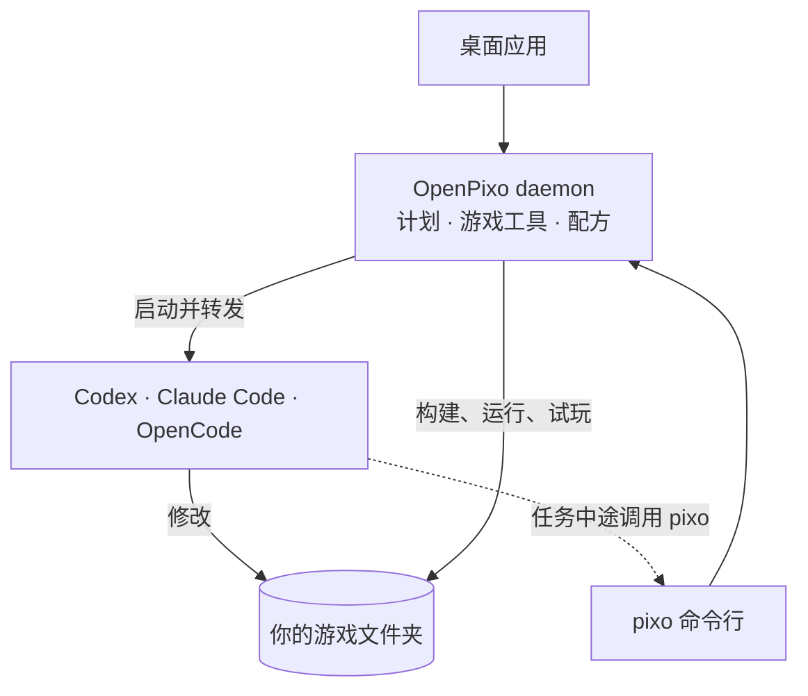

<p align="center">
  
</p>

<h1 align="center">OpenPixo</h1>

<p align="center">
  <b>让你正在用的编程 agent 变成游戏开发者。</b><br>
  OpenPixo 在你真实的游戏项目上运行 Codex、Claude Code 或 OpenCode，让它能看到、玩到并给游戏做美术，而不只是写代码。
</p>

<p align="center">
  <a href="https://openpixo.com/download.zh"></a>
  <a href="LICENSE"></a>
  
</p>

<p align="center">
  <a href="#安装">安装</a> ·
  <a href="#快速上手">快速上手</a> ·
  <a href="#工作原理">工作原理</a> ·
  <a href="#文档">文档</a> ·
  <a href="README.md">English</a>
</p>

<p align="center"></p>
<p align="center"><sub><b>《樱夜·妖潮》</b>：Codex 在 OpenPixo 里分五个阶段做完。代码、精灵图、动画和界面美术都由 agent 完成，每个阶段它都自己试玩过。</sub></p>

## 为什么选 OpenPixo

- **用你已经在付钱的 AI。** 在你电脑上运行 Codex、Claude Code 或 OpenCode 命令行，用你自己的订阅或 API key，不用再额外付费。
- **它会玩游戏，不只是编译。** 构建并运行游戏，用脚本化的键盘鼠标输入试玩，再看截图，能发现“构建通过”掩盖不了的问题。
- **美术、音效和 3D 在同一个流程里。** 配方能做精灵图、行走动画、地块、图标、特效、音乐和 3D 模型，抠好图、按你的引擎裁好尺寸。
- **先由你拍板，再动手。** 每个新游戏都先出一份简短的计划。你批准前 agent 只能读不能改，它也不能自己提高美术预算。
- **真实的引擎，你自己的文件夹。** 支持 Godot、Unity、Phaser 和普通网页游戏，新建项目或打开已有项目都行，文件留在原处。
- **从头到尾都能脚本化。** 应用里的每项功能都有对应的 `pixo` 命令，支持 `--json` 输出，CI 和其他 agent 也能用。

## 安装

### Windows 应用

1. 到 **[openpixo.com 下载页](https://openpixo.com/download.zh)**下载安装包（Windows 10 或 11，x64）。
2. 运行安装包。之后更新会自动安装。
3. 第一次打开时接入一个 AI：你已登录的 Codex、Claude Code 或 OpenCode 命令行，或者你自己的 API key。登录 OpenPixo 使用托管模型是可选的。

> [!NOTE]
> 安装包暂未代码签名，Windows SmartScreen 会提示“未知发布者”。请用 PowerShell 的 `Get-FileHash` 核对文件 SHA256 与[下载页](https://openpixo.com/download.zh)上的数值一致，再选择 **更多信息 → 仍要运行**。

### 从源码运行

需要 Node 24、pnpm 10.33.2 和 Visual Studio Build Tools 2022 或更新版本（有一个原生依赖要从源码编译）。

```powershell
git clone https://github.com/OpenPixo/OpenPixo.git
cd OpenPixo
pnpm install
pnpm tools-dev        # 启动 daemon、网页界面和桌面应用
```

状态、日志和停止见 `pnpm tools-dev --help`。目前支持 Windows；macOS 和 Linux 的工具链仍能构建，但没有按发布标准测试。遇到问题见 [Windows 排障](docs/windows-troubleshooting.md)。

## 快速上手

1. **开始一个游戏。** 点 **新建游戏**，用一句话描述它，或者打开一个已经有游戏的文件夹。
2. **商量好计划。** agent 会和你依次确认玩法、画风和引擎，给你看几张画风小样，然后提出 3–6 个阶段。你批准之前什么都不会做。
3. **每个阶段都玩一下。** 它每轮做一个阶段，自己试玩，再告诉你怎么试。用游戏面板里的 **运行**、**试玩** 和 **调参**，或者直接告诉它哪里感觉不对。

同样的工具也能在终端里用，或者交给在别的仓库里工作的 agent：

```powershell
pixo game verify --screenshot          # 构建、运行并截一帧
pixo game playtest --preset runJump    # 用脚本化输入试玩
pixo recipe run tileset-seamless --input material="mossy cobblestone" --wait
pixo --help
```

## 工作原理



本地的 daemon 管理你的项目，桌面应用和 `pixo` 命令行调用的是同一套 API。你发消息时，daemon 在游戏文件夹里启动你的 agent 命令行，带上游戏开发提示词和这次任务需要的技能。agent 再自己调用 `pixo` 去构建、试玩和做美术。计划审批和美术预算由 daemon 强制执行，不只是写在提示词里。

更多：[架构](docs/architecture.md) · [Agent 适配](docs/agent-adapters.md) · [提示词组合](docs/prompt-composition.md)

## 文档

- **使用：** [快速开始](QUICKSTART.md) · [运行与构建](docs/RUNNING.md) · [通过 REST 无界面运行](docs/headless-byok.md) · [隐私](PRIVACY.md)
- **扩展：** [技能](docs/skills-protocol.md)（[`skills/`](skills/) 内置 31 个） · [插件与配方](docs/plugins-spec.zh-CN.md) · [发布插件](docs/publishing-a-plugin.zh-CN.md)
- **参与开发：** [AGENTS.md](AGENTS.md)（仓库规则，写给人也写给编程 agent） · [ADR](docs/adr/) · [术语表](docs/glossary.md)

## 参与贡献

欢迎在 [issues](https://github.com/OpenPixo/OpenPixo/issues) 提问题、想法和 pull request。请先读[贡献指南](docs/i18n/CONTRIBUTING.zh-CN.md)，较大的功能先开 issue 讨论。安全问题见 [SECURITY.md](.github/SECURITY.md)。

## 许可证

[Apache-2.0](LICENSE)。OpenPixo 最初是另一个 Apache-2.0 项目的硬分叉；署名见 [NOTICE](NOTICE) 与[引用记录](docs/references.md)。
