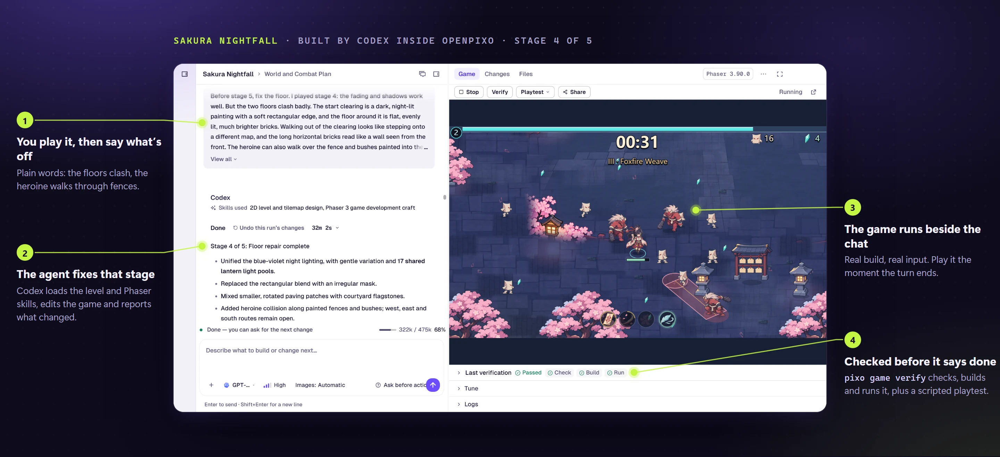
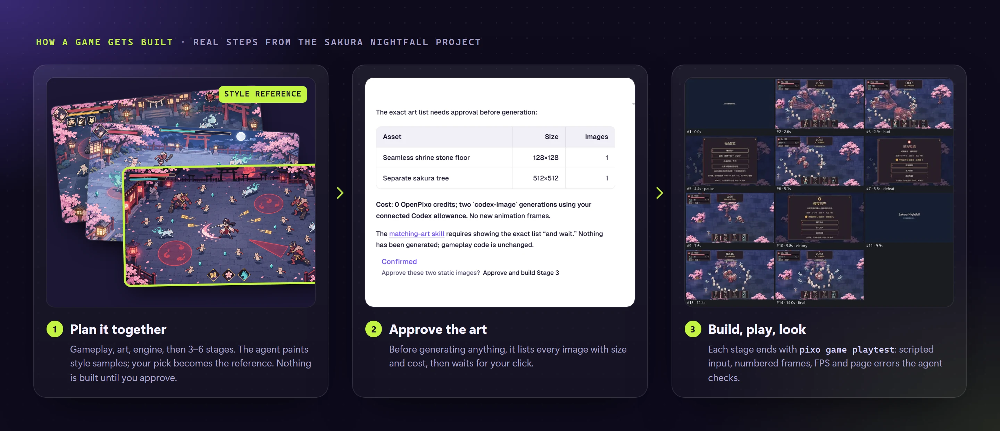
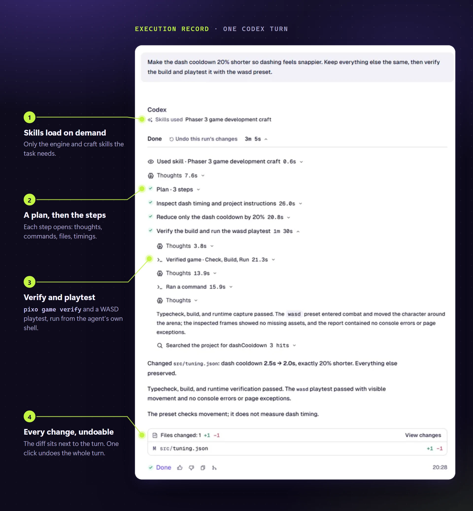
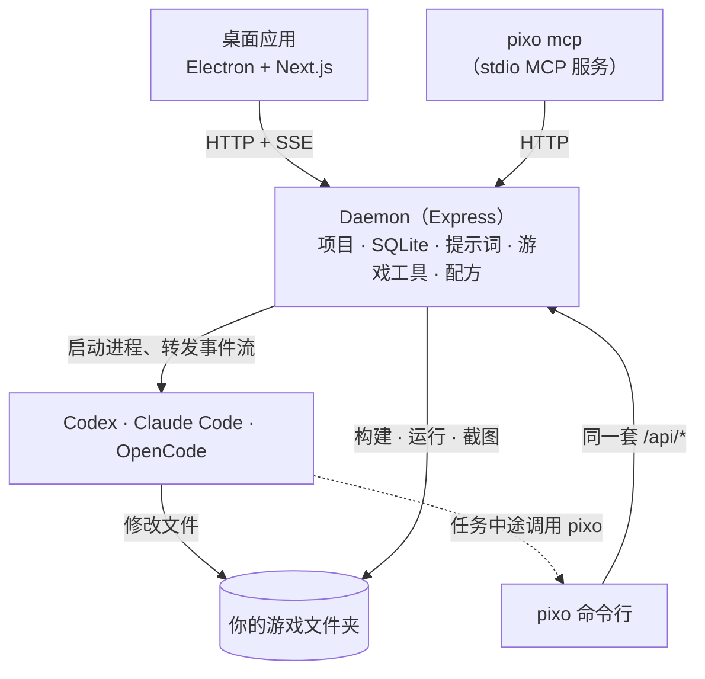

<p align="center">
  
</p>

<h1 align="center">OpenPixo</h1>

<p align="center">
  <b>把编程 agent 变成游戏开发者的开源工作台。</b><br>
  OpenPixo 在你的游戏项目上运行 Codex、Claude Code 或 OpenCode，补上编程 agent 做游戏时缺的工具：<br>
  懂引擎的构建和运行、脚本化试玩、素材管线、游戏开发技能，以及先定计划再动手的流程。
</p>

<p align="center">
  <a href="https://openpixo.com/download.zh"></a>
  <a href="LICENSE"></a>
  
  
</p>

<p align="center">
  <a href="#安装">安装</a> ·
  <a href="#快速上手">快速上手</a> ·
  <a href="#架构">架构</a> ·
  <a href="#pixo-命令行">命令行</a> ·
  <a href="#扩展-openpixo">扩展</a> ·
  <a href="#开发">开发</a> ·
  <a href="README.md">English</a>
</p>

<p align="center"></p>
<p align="center"><sub>《Sakura Nightfall》是 Codex 在 OpenPixo 里分五个阶段做出来的 Phaser 游戏。用户玩一个阶段、说出问题，agent 修好，<code>pixo game verify</code> 通过后这一轮才算完成。</sub></p>

## OpenPixo 是什么？

通用编程 agent 能写游戏代码，却看不到游戏本身：它不知道怎么构建 Godot 项目，不会在运行中的 Phaser 游戏里按键，也做不了精灵图。OpenPixo 是夹在 agent 和项目之间的本地应用和 daemon。它启动你已经装好的 agent 命令行，在提示词里加上游戏开发的上下文，并提供构建、试玩、素材和调参工具，agent 在任务中途以 `pixo` 命令调用它们。你在桌面应用里使用它；脚本和其他 agent 通过命令行使用同一套工具。

<p align="center"></p>

## 功能

**Agent 运行框架**
- 运行你自己安装和订阅的 **Codex**、**Claude Code** 或 **OpenCode**，也可以用 OpenCode 加你自己的 API key（BYOK）。
- 每一轮都实时显示在执行记录里：用了哪些技能、计划步骤、工具调用、改了哪些文件、生成了哪些素材、上下文用量。
- 可以在一轮运行中途引导它，撤销一轮的文件改动，并跨轮次续接 agent 原生会话。

<p align="center"></p>

**游戏循环**
- 识别引擎，推出这个项目的检查、构建和运行命令。
- `pixo game verify` 构建并运行游戏，可以截图。
- `pixo game playtest` 用脚本化的键盘鼠标输入试玩。预设覆盖横版、WASD、网格点击、拖拽，以及可以精确回放的带种子随机输入。
- `pixo game tuning` 把 Godot 场景、脚本和网页 JSON 数据里的数值、开关和颜色做成滑块，修改受文件哈希和检查点保护。
- `pixo game export` 把网页游戏打包成一个可离线游玩的 HTML 文件。

**素材**
- 30 个配方：13 个素材配方（8 方向行走动画、角色三视图、无缝地块、图标集、特效序列、视差背景、天空盒、九宫格界面、PBR 贴图、音效包、循环音乐、角色配音、图片转 3D），10 个游戏起步模板，7 个功能配方（存档、设置、对话、背包、手柄、多语言、成就）。
- 配方结果先作为候选暂存，由你或 agent 明确采用；每个采用的文件都记录来源：配方、模型、提示词和种子。
- 面向引擎的确定性图片处理：裁切、去边、补齐到 2 的幂、最近邻缩放、翻转和旋转。

**安全边界**
- 新游戏先规划再制作。规划期间每种运行时都是只读的：Codex 用 `read-only` 沙箱，Claude Code 去掉编辑工具，OpenCode 加上拒绝规则。只有用户能批准计划，批准接口会拒绝 agent 的令牌。
- 每个媒体请求都由 daemon 自己定价，并从只有用户能设定的美术预算里预留。

**自动化**
- 每项面向用户的功能都是一个 `pixo` 子命令，支持 `--json` 输出和 `--prompt-file` 输入。
- `pixo mcp` 运行一个 stdio MCP 服务，在其他仓库里工作的 agent 也能使用 OpenPixo 项目。
- 可以用你自己的模型服务商通过 REST 无界面运行（[说明](docs/headless-byok.md)）。

## 安装

### Windows 应用

1. 到 **[openpixo.com 下载页](https://openpixo.com/download.zh)**下载安装包（Windows 10 或 11，x64）。
2. 运行安装包。之后更新会自动安装。
3. 第一次打开时接入一个 AI：你已登录的 Codex、Claude Code 或 OpenCode 命令行，或者你自己的 API key。OpenPixo 账号（用于托管模型）是可选的。

> [!NOTE]
> 安装包暂未代码签名，Windows SmartScreen 会提示“未知发布者”。请用 PowerShell 的 `Get-FileHash` 核对文件 SHA256 与[下载页](https://openpixo.com/download.zh)上的数值一致，再选择 **更多信息 → 仍要运行**。

### 从源码运行

需要 Node 24、pnpm 10.33.2，以及 Visual Studio Build Tools 2022 或更新版本（`better-sqlite3` 在 Node 24 上要从源码编译）。

```powershell
git clone https://github.com/OpenPixo/OpenPixo.git
cd OpenPixo
pnpm install
pnpm tools-dev                 # 启动 daemon、网页界面和桌面应用，端口自动分配
```

`pnpm tools-dev run web` 只启动 daemon 和网页界面；状态、日志和停止见 `pnpm tools-dev --help`。Windows 是发布平台；macOS 和 Linux 的工具链仍能构建，但没有按发布标准测试。环境问题见 [Windows 排障](docs/windows-troubleshooting.md)。

## 快速上手

1. **开始一个游戏。** 点 **新建游戏** 描述它，或者打开一个已经有游戏的文件夹。
2. **商量好计划。** agent 和你确认玩法、画风和引擎，给你看画风小样，然后提出 3–6 个阶段。你批准之前它不会写任何文件。
3. **边做边玩。** 它每轮做一个阶段，验证并试玩，再告诉你怎么试。用游戏面板里的 **运行**、**试玩** 和 **调参**，或者直接告诉它哪里感觉不对。

## 支持的 agent

| 运行时 | OpenPixo 怎么驱动它 | 说明 |
| --- | --- | --- |
| Codex | `codex app-server`，通过 stdio 的 JSON-RPC | 会话跨轮次续接；用你的 ChatGPT 登录生图 |
| Claude Code | `claude -p`，输入输出都是 stream-json | stdin 保持打开，运行中途可以引导 |
| OpenCode | OpenCode JSON 事件 | 内置的 OpenCode 也用来跑 BYOK 服务商 |

每种运行时都是 [`apps/daemon/src/runtimes/defs/`](apps/daemon/src/runtimes/defs/) 里的一个声明式定义。解析器用真实 CLI 的录制会话测试，[`mocks/`](mocks/README.md) 把这些录制回放成可直接替换的假 CLI。详见 [docs/agent-adapters.md](docs/agent-adapters.md)。

## 支持的引擎

| 引擎 | 识别依据 | 检查 / 构建 / 运行 | 脚本化试玩 | 起步模板 |
| --- | --- | --- | --- | --- |
| Godot 4 | `project.godot` | 无界面导入；设置了导出预设时导出；运行 | ✓（MovieMaker 录制） | 10 |
| Phaser、three.js、普通网页 | `package.json`、`index.html` | 项目自己的 `check`、`build`、`dev`（或 `preview`）脚本 | ✓（应用内浏览器） | 10（Phaser） |
| Unity | `ProjectSettings/ProjectVersion.txt` | 批处理模式检查；项目有编辑器构建方法时构建 | — | — |
| Bevy | `Cargo.toml` | `cargo check`、`cargo run` | — | — |
| Cocos Creator 3 | `project.json` | 命令行构建 | — | — |
| Unreal、RPG Maker | `.uproject`、`.rmmzproject` | 能识别；用项目自己的工具 | — | — |

引擎工具从 `PATH` 查找，或在设置里指定。

## 架构



- **唯一的权威。** 本地 daemon（`apps/daemon`）负责 `/api/*`、持久化、agent 运行和游戏工具。界面和命令行调用同一套接口，共享类型在 [`packages/contracts`](packages/contracts/)。
- **agent 会回调进来。** 被启动的 agent 拿到一个限定范围的令牌和项目 id，在自己的 shell 里运行 `pixo game verify` 或 `pixo recipe run`。属于用户的操作（比如批准计划或预算）会拒绝这个令牌。
- **文件留在原处。** 导入的游戏就地修改。daemon 的状态都放在一个解析出来的数据根目录下（[约定](AGENTS.md#daemon-data-directory-contract)）。

更多：[架构](docs/architecture.md) · [提示词组合](docs/prompt-composition.md) · [Skills 协议](docs/skills-protocol.md)

## `pixo` 命令行

```powershell
pixo game verify --steps check,build,run --screenshot --json
pixo game playtest --preset runJump --json
pixo game playtest --preset monkey --seed 42 --duration 15
pixo game tuning list --json
pixo game export --out build/my-game.html

pixo recipe list --surface image --engine godot
pixo recipe run tileset-seamless --input material="mossy cobblestone" --wait --json
pixo recipe adopt <runId> --candidate <id>

pixo asset edit <projectId> art/hero.png --trim --pad pot --nearest
pixo asset provenance art/hero.png

pixo mcp templates
pixo --help
```

## 扩展 OpenPixo

扩展都是普通文件夹。daemon 还会扫描一个用户可写的目录，同 id 的自有副本会覆盖内置的那份。

| 扩展 | 位置 | 格式 |
| --- | --- | --- |
| 技能（31） | [`skills/`](skills/) | 带 frontmatter 的 `SKILL.md`：触发词、引擎、模式。只在任务需要时读取。[协议](docs/skills-protocol.md) |
| 配方（30） | [`plugins/_official/recipes/`](plugins/_official/recipes/) | `pixo.json`（`urn:openpixo:plugin:v1`），声明带类型的输入、目标引擎、后处理和检查 |
| 画风（20） | [`plugins/_official/styles/`](plugins/_official/styles/) | 纯数据的画风片段、调色板和约束，项目可以固定一个 |
| 插件 | [`plugins/`](plugins/README.zh-CN.md) | 带市场元数据的可安装包。[规范](docs/plugins-spec.zh-CN.md) · [发布](docs/publishing-a-plugin.zh-CN.md) |
| MCP 服务 | 设置、`pixo mcp add` | 每次运行时传给 agent 的外部工具 |

## 开发

```text
apps/
  daemon/      Express daemon 和 pixo 命令行
  web/         Next.js 16 界面（React 18）
  desktop/     Electron 外壳
  packaged/    Windows 安装包的打包运行时
packages/
  contracts/   纯 TypeScript 的 API 契约和共享的游戏提示词
  sidecar*/    所有启动器共用的进程身份、IPC 和生命周期
tools/
  dev/         pnpm tools-dev，本地生命周期入口
  pack/        安装包、自动更新、打包冒烟测试
skills/  plugins/  mocks/  e2e/
```

```powershell
pnpm guard                              # 仓库规则检查
pnpm typecheck
pnpm --filter @openpixo/daemon test     # 测试按包运行
pnpm tools-pack win build --to nsis     # 构建 Windows 安装包
```

改代码前请先读 [AGENTS.md](AGENTS.md)。它写明了仓库的边界和约定，同时写给人和编程 agent；每一层（`apps/`、`packages/`、`tools/`、`e2e/`）都有自己的一份。

## 参与贡献

欢迎在 [issues](https://github.com/OpenPixo/OpenPixo/issues) 提问题、想法和 pull request。请先读[贡献指南](docs/i18n/CONTRIBUTING.zh-CN.md)，较大的功能先开 issue 讨论。安全问题请按 [SECURITY.md](.github/SECURITY.md) 私下报告。

## 许可证

[Apache-2.0](LICENSE)。OpenPixo 最初是另一个 Apache-2.0 项目的硬分叉，现已不再跟进上游（[ADR 0006](docs/adr/0006-full-hard-fork.md)）；署名见 [NOTICE](NOTICE) 与[引用记录](docs/references.md)。内置的技能和组件保留各自的许可证。
