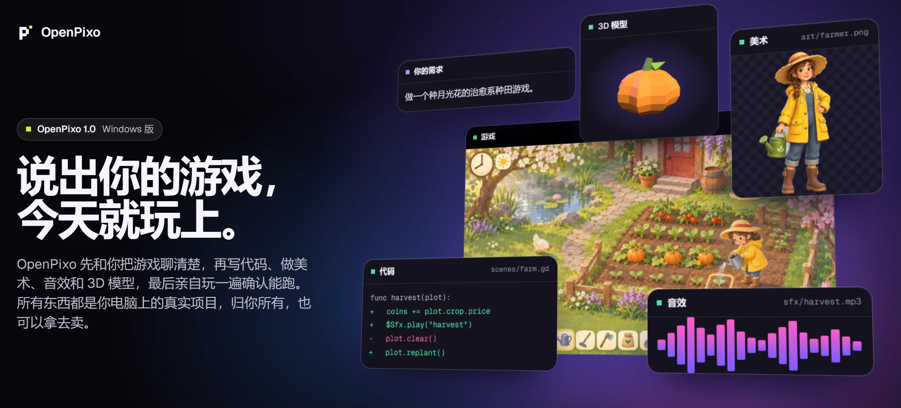
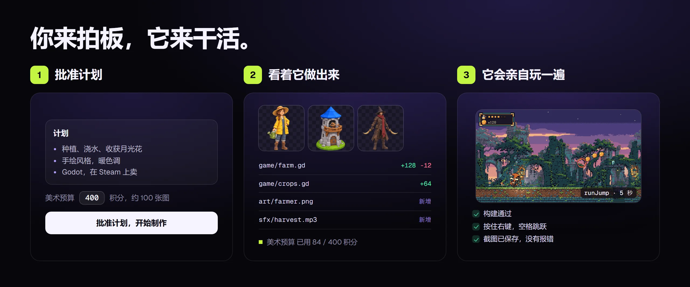
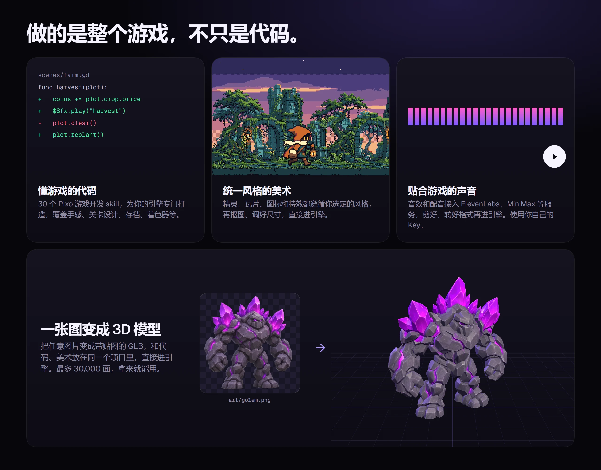
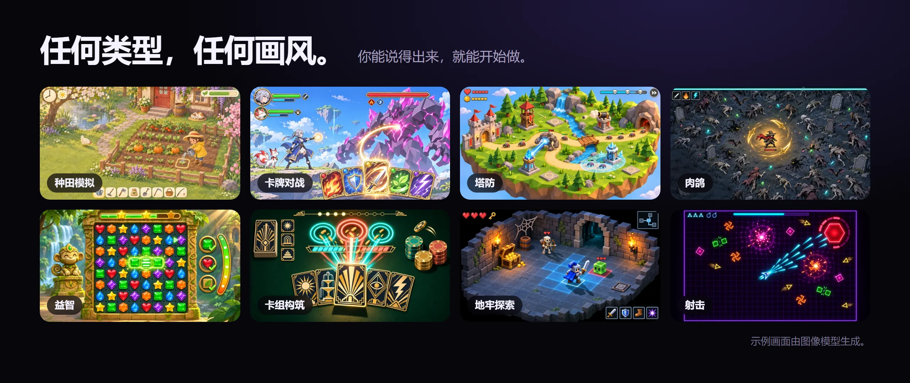
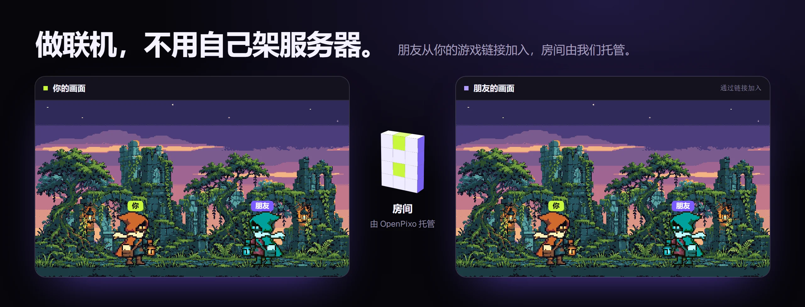

<p align="center">
  <a href="https://openpixo.com/zh"></a>
</p>

<p align="center">
  <b>独立游戏开发者的 AI 工作台。</b><br>
  代码、美术、音效、3D 模型和试玩都在一个应用里，做出来的是你电脑上的真实项目。
</p>

<p align="center">
  <a href="https://openpixo.com/download.zh"></a>
  <a href="LICENSE"></a>
</p>

<p align="center">
  <a href="https://openpixo.com/zh">官网</a> ·
  <a href="https://openpixo.com/download.zh">下载</a> ·
  <a href="https://openpixo.com/pricing.zh">价格</a> ·
  <a href="https://openpixo.com/changelog.zh">更新日志</a> ·
  <a href="README.md">English</a>
</p>

## 安装

1. **下载**：到 [openpixo.com 下载页](https://openpixo.com/download.zh)下载安装包（Windows 10 或 11，x64）。
2. **运行安装包**。之后的更新会自动下载安装。
3. **选择 AI**：接入你已有的 Codex、Claude Code 或 OpenCode 订阅，或者登录后直接用托管模型，不需要 API key。
4. **说出你的游戏**：回答几个问题，批准计划，它就开始做。

> [!NOTE]
> 安装包暂未代码签名，Windows SmartScreen 会提示“未知发布者”。请先用 PowerShell 的 `Get-FileHash` 核对文件 SHA256 与[下载页](https://openpixo.com/download.zh)上的数值一致，再选择 **更多信息 → 仍要运行**。

## 怎么用

<p align="center"></p>

- **先聊清楚再动手。** 每个新游戏都按玩法、画风、引擎与技术、计划一步一步确认。计划没批准，什么都不会做。
- **花费你说了算。** 批准计划时设定美术预算，agent 自己不能加。
- **一个阶段一个阶段地做。** 每轮做一个阶段，告诉你怎么试，然后等你。改了哪些文件、做了哪些素材，都直接显示在聊天里。
- **它会自己玩一遍。** 内置试玩会运行构建、按键操作、查看截图，能发现代码审查发现不了的问题。

## 整个游戏，不只是代码

<p align="center"></p>

- **30 个游戏开发技能**：手感、关卡设计、存档、界面、着色器、联机、Steam 发布等，agent 按问题读需要的那几个。
- **美术配方**：行走动画、角色三视图、无缝地块、图标、特效、视差背景、天空盒和界面九宫格，抠好图、裁成引擎要的尺寸。
- **Godot、Phaser 和 Unity**，另有 10 个游戏起步模板和 7 个功能配方：存档、设置、对话、背包、手柄、多语言和成就。
- **你的文件夹**：打开已有的游戏，或者新建一个。文件留在原处，是你自己的普通项目。

## 任何类型，任何画风

<p align="center"></p>

种田、卡牌对战、塔防、幸存者、消除解谜、构筑卡牌、地牢、射击，还有你接下来想得到的任何类型。

## 分享出去，一起玩

<p align="center"></p>

- **一键发布。** 把网页游戏放到公开链接上，玩家什么都不用装。
- **在线功能。** 让 AI 加排行榜、云存档、幽灵车或异步对战，后端由 OpenPixo 托管。
- **联机房间。** agent 用联机技能写网络代码，并用两个玩家实测。朋友从你的游戏链接加入托管房间，不用自己架服务器。

## 用你的 AI，或者用我们的

- **用自己的。** OpenPixo 可以跑在你已有的 Codex、Claude Code 或 OpenCode 上，不额外收费。
- **或者用我们的。** 登录后就能用托管模型、美术、音效、3D 和公开链接，不用管 API key。详见[价格](https://openpixo.com/pricing.zh)。

## 也为 agent 而做

应用里的每项功能都有对应的 `pixo` 命令，正在做你游戏的 agent 或任何其他 agent，都能在任务中途用同样的工具。命令支持 `--json`，长提示词可以从文件读入。

```powershell
pixo game verify        # 构建游戏并检查能否运行
pixo game playtest      # 用脚本化输入试玩并保存截图
pixo recipe --help      # 精灵图、地块、图标、特效、音效包、3D
pixo asset --help       # 为引擎抠图、缩放、切片和检查素材
```

## 从源码构建

在 Windows 上使用 Node 24 和 pnpm 10.33.2。原生依赖需要 Visual Studio Build Tools，见[贡献指南](docs/i18n/CONTRIBUTING.zh-CN.md)和 [Windows 排障](docs/windows-troubleshooting.md)。

```powershell
pnpm install
pnpm tools-dev
```

`pnpm tools-dev` 是唯一的开发生命周期入口，启动、状态、日志和停止见 `pnpm tools-dev --help`。贡献者和编程 agent 请先读 [AGENTS.md](AGENTS.md)。

## 文档

- [快速开始](QUICKSTART.md) · [贡献指南](docs/i18n/CONTRIBUTING.zh-CN.md) · [Contributing](CONTRIBUTING.md)
- [运行与构建](docs/RUNNING.md) · [架构](docs/architecture.md) · [提示词组合](docs/prompt-composition.md)
- [Skills 协议](docs/skills-protocol.md) · [插件编写](docs/publishing-a-plugin.zh-CN.md) · [隐私](PRIVACY.md)

## 许可证

[Apache-2.0](LICENSE)。OpenPixo 最初派生自另一个 Apache-2.0 项目，署名见 [NOTICE](NOTICE) 与[引用记录](docs/references.md)。内置组件保留各自的许可证。

<sub>本页图片中的示例画面、美术和模型由 OpenPixo 的配方提示词生成，实际效果因模型而异。</sub>
